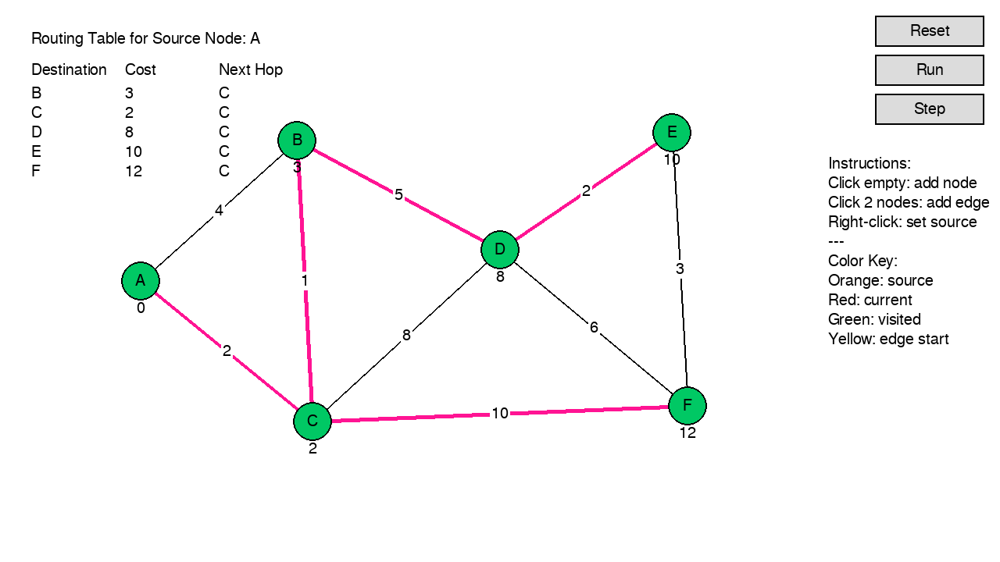

# Dijkstra & Link-State Routing Visualizer

An interactive Pygame tool for stepping through Dijkstra's shortest-path algorithm, the computation every router runs in a link-state protocol such as OSPF. You build a network, then watch it produce the source router's routing table.


<p align="center">
  
</p>

---

## Why

In link-state routing, every router learns the full topology and runs Dijkstra locally to choose a next hop for each destination. Textbook diagrams show only the final answer. This tool shows each step: which router is being settled, how tentative costs fall, and how the shortest-path tree and forwarding table come out of it.

## Features

- **Build any topology.** Click to place routers (named A, B, C…), click two routers to add a link and type its cost.
- **Step-by-step execution.** *Run* starts the algorithm and *Step* advances one decision at a time.
- **Live state.** Nodes are coloured by state (source, current, visited) and their tentative distance is shown underneath.
- **Shortest-path tree.** The final tree is highlighted on the graph.
- **Routing table.** Destination, total cost and **next hop** for the source router, derived from the predecessor map.

## How it works

| File | Responsibility |
|---|---|
| `graph.py` | Undirected weighted graph (node positions plus adjacency) |
| `dijkstra.py` | Dijkstra with a binary heap (`heapq`), written as a **generator** that yields the algorithm's state after every settle and relaxation, so the UI can pause between steps |
| `ui.py` | Drawing nodes, edges, buttons and the routing table; the next-hop lookup walks predecessors back to the source |
| `main.py` | Event loop, interaction state and rendering |

Writing the algorithm as a generator keeps the algorithm and the visualisation separate: `dijkstra.py` has no Pygame code. Complexity is O((V + E) log V).

## Getting started

```bash
git clone https://github.com/Rishikesh10925/Dijkstra-and-Link-State-Routing-Visualizer.git
cd Dijkstra-and-Link-State-Routing-Visualizer
python -m venv venv
source venv/bin/activate          # Windows: venv\Scripts\activate
pip install -r requirements.txt
cd Dijkstra_Visualizer
python main.py
```

## Controls

| Action | Input |
|---|---|
| Add a router | Left-click on empty canvas |
| Add a link | Left-click a router, then another, then type the cost and press Enter |
| Set the source router | Right-click a router |
| Start / advance / clear | **Run**, **Step**, **Reset** buttons |

Colours: orange = source, red = node being settled, green = settled, yellow = first end of a link being drawn.

## Possible extensions

- Show the priority queue contents at each step
- Save and load topologies
- Simulate a link failure and the resulting re-convergence
- Compare with distance-vector routing (Bellman–Ford)

## Author

Built by [Rishikesh](https://github.com/Rishikesh10925).
